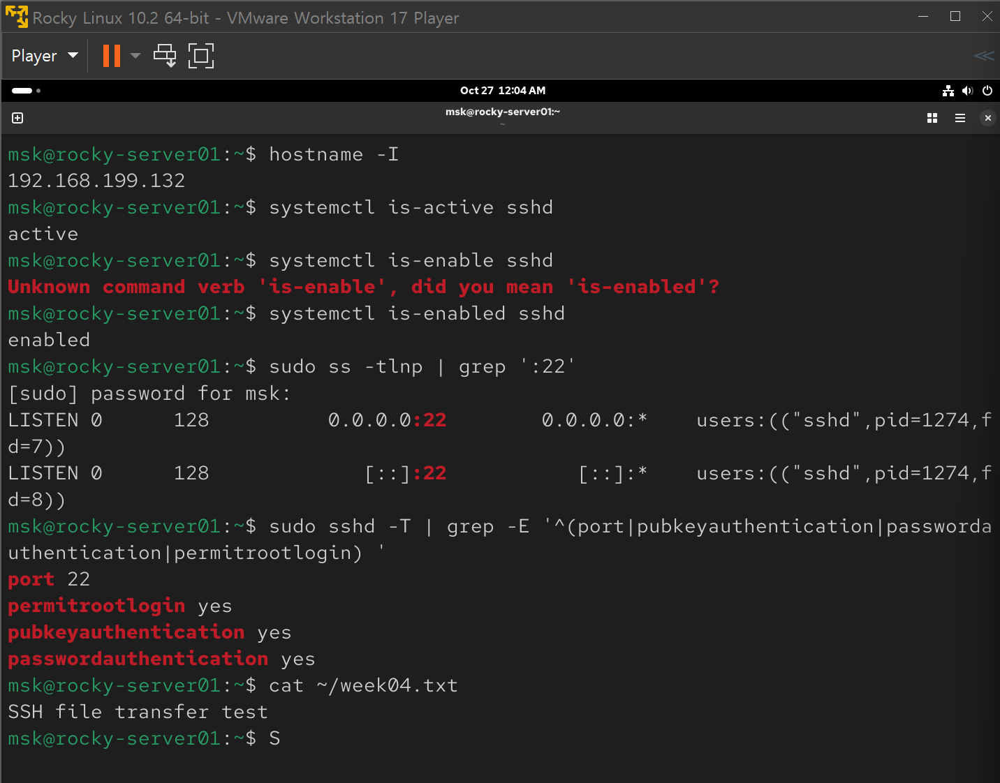
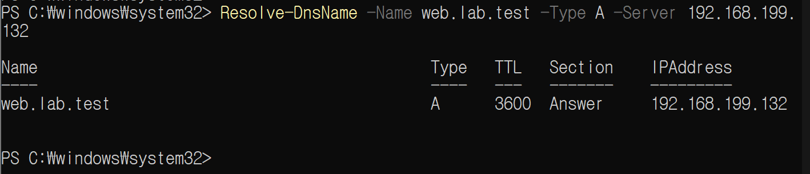
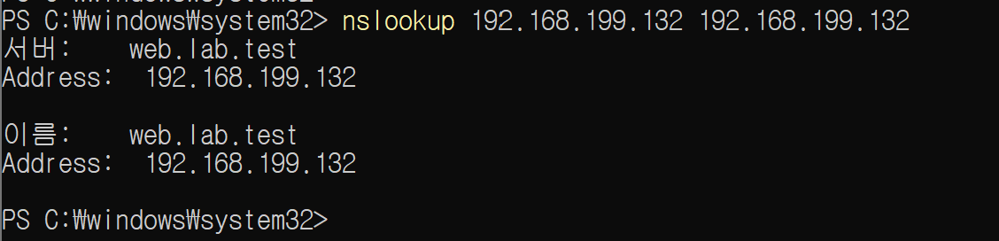

# Week 04 — 원격지 시스템 관리와 DNS 서버 구축

> **교재 기준:** 『이것이 리눅스다 with Rocky Linux 10』 Chapter 8(원격지 시스템 관리), Chapter 9(네임 서버)
> **환경:** Windows 호스트 + VMware Workstation 17 Player + Rocky Linux 10.2 (`rocky-server01`)
> **학습 방법:** 교재 개념 → 직접 구축 → 서비스/포트 확인 → Windows 클라이언트 검증 → 보안 관점 설명
> **진행 현황:** 주요 SSH·DNS 실습 완료 · Telnet 이론 학습 · 원격 GUI(XRDP/GNOME RDP)는 미검증

## 0. 처음 방문했을 때 읽는 순서

- **3분 요약:** 이 README의 [핵심 성과](#1-핵심-성과)를 읽는다.
- **Chapter 8 복습:** [SSH/Telnet/원격 관리 상세 노트](docs/chapter08-remote-access.md) → 공개키 인증
- **Chapter 9 복습:** [DNS·BIND 상세 노트](docs/chapter09-dns.md) → 정방향/역방향 질의를 설명한다.
- **명령어가 기억나지 않을 때:** [명령어 해설 및 재현 가이드](docs/command-reference.md).
- **오류가 발생할 때:** [트러블슈팅](docs/troubleshooting.md).
- **책 덮고 시험 보기:** [예상 질문·답안](docs/review-questions.md).

> **기록 원칙:** 아래에서 '완료'는 실제 실습 화면으로 확인된 내용만 뜻한다. 권장 보안 설정이나 추가 학습용 예제를 실제 수행했다고 표기하지 않는다. 장치 이름·IP·경로는 실습 당시 값이므로 재현 시 반드시 다시 확인한다.

---

## 1. 핵심 성과

| 범위              | 실제 수행·검증 내용                                                                                              | 상태                      |
| ----------------- | ---------------------------------------------------------------------------------------------------------------- | ------------------------- |
| Ch 8.1 Telnet     | Telnet(TCP 23)과 SSH(TCP 22)의 암호화 차이 비교, 개념 학습                                                       | 이론                      |
| Ch 8.2 SSH 서버   | `sshd` 실행·자동 시작, TCP 22 LISTEN, 적용 인증 설정 확인                                                        | ✅                        |
| Ch 8.2 SSH 공개키 | Windows에서 ED25519 키 쌍 생성 → Linux `authorized_keys` 등록 → 비밀번호 인증 비허용 옵션으로 실제 공개키 로그인 | ✅                        |
| Ch 8.2 SCP        | Windows에서 `week04.txt` 전송 → Rocky에서 `SSH file transfer test` 확인                                          | ✅                        |
| Ch 8.3 원격 GUI   | 교재의 XRDP와 Rocky Linux 10의 GNOME RDP 구분                                                                    | 실제 GUI 접속 **미검증**  |
| Ch 9.1 DNS 기초   | `dig`/`Resolve-DnsName`/`nslookup`, DNS A·PTR 질의 이해                                                          | ✅                        |
| Ch 9.2 BIND       | `bind`, `bind-utils` 설치, `named` 서비스 활성화, Zone 작성·구문 검사                                            | ✅                        |
| Ch 9.2 정방향     | `web.lab.test` → `192.168.199.132` (Rocky 및 Windows)                                                            | ✅                        |
| Ch 9.2 역방향     | `192.168.199.132` → `web.lab.test` (Rocky 및 Windows)                                                            | ✅                        |
| 보안 마무리       | SSH 설정 강화 적용, DNS 포트 영구 규칙·재부팅 검증                                                               | **미실시/추가 검증 필요** |

### 실습에서 사용한 주소

| 항목             | 당시 값           | 의미                                       |
| ---------------- | ----------------- | ------------------------------------------ |
| Rocky 호스트명   | `rocky-server01`  | SSH 원격 관리 서버                         |
| Rocky 실습 IP    | `192.168.199.132` | VMware NAT 사설 네트워크                   |
| 실습 DNS 영역    | `lab.test`        | 외부에 등록한 도메인이 아닌 내부 실습 영역 |
| DNS 서버 호스트  | `ns.lab.test`     | NS 레코드 대상                             |
| 웹 테스트 호스트 | `web.lab.test`    | A/PTR 레코드로 조회                        |
| SSH 포트         | TCP `22`          | OpenSSH                                    |
| DNS 포트         | UDP/TCP `53`      | BIND(`named`)                              |

> 공개 저장소에서는 실습용 **사설 IP**는 구조 설명용으로 남겼지만, 새로운 네트워크에 이 설정을 그대로 복사하면 동작하지 않을 수 있다. 실제 공개 서버에는 별도 접근제어가 필요하다.

---

## 2. 전체 아키텍처

```text
Windows 호스트 (SSH/DNS Client)
       │
       │ VMware NAT 네트워크 192.168.199.0/24
       │
       ├──────── TCP 22 ────────────┐
       │                            │
       │      SSH + SCP             │
       │  ┌─ ED25519 private key    │
       │  └─ 서버 authorized_keys   ▼
       │                     ┌──────────────────────┐
       └──── UDP/TCP 53 ────>│ Rocky Linux 10.2     │
                             │ 192.168.199.132     │
                             │                      │
                             │ sshd: 원격 관리      │
                             │ named: 권한 DNS 응답 │
                             └──────────┬───────────┘
                                        │
                             ┌──────────┴───────────┐
                             │ lab.test              │
                             │ ns  A   192.168.199.132
                             │ web A   192.168.199.132
                             │ 132 PTR web.lab.test. │
                             └───────────────────────┘
```

**중요:** Windows의 시스템 전체 DNS 설정을 이 서버로 변경한 것이 아니라, PowerShell에서 DNS 서버 주소를 **직접 지정해 질의**했다.

---

## 3. Chapter 8 — 원격지 시스템 관리

### 3.1 왜 Telnet보다 SSH를 사용하는가?

Telnet은 기본적으로 터미널 통신에 암호화가 제공되지 않으므로 계정 정보와 명령이 노출될 수 있다. SSH는 서버 신원 확인, 암호화된 통신 채널, 사용자 인증 등을 제공한다. 실습용 서버에 Telnet 서비스를 외부에 노출하지 않았다.

### 3.2 실행·포트·설정 확인

```bash
hostname -I
systemctl is-active sshd
systemctl is-enabled sshd
sudo ss -tlnp | grep ':22'
sudo sshd -T | grep -E '^(port|pubkeyauthentication|passwordauthentication|permitrootlogin) '
```

확인된 내용:

```text
IP: 192.168.199.132
sshd: active / enabled
TCP: 0.0.0.0:22, [::]:22 LISTEN
port 22
pubkeyauthentication yes
passwordauthentication yes
permitrootlogin yes
```

- `systemctl` = 서비스 실행·부팅 연동 상태
- `ss` = 실제 네트워크 포트 바인딩
- `sshd -T` = SSH 데몬의 적용 설정을 확인(일반적인 설정 컨텍스트 기준)

**보안 메모:** 실습 시점에는 `permitrootlogin yes`, `passwordauthentication yes`가 확인됐다. **SSH 키 인증 성공만 확인했으며 이를 비활성화하거나 강화했다고 기록하지 않는다.** 설정 변경은 기존 접속 유지·백업·별도 세션 테스트 후 수행해야 한다.

### 3.3 공개키 인증

**Windows PowerShell:**

```powershell
# 동일 경로에 이미 키가 있으면 덮어쓰지 말 것
ssh-keygen -t ed25519 -f "$env:USERPROFILE\.ssh\id_ed25519_rocky_lab" -C "rocky-lab"
$ip = "192.168.199.132"
$server = "msk@$ip"

# 공개키(.pub)만 Rocky 계정에 등록
Get-Content "$env:USERPROFILE\.ssh\id_ed25519_rocky_lab.pub" |
    ssh $server "umask 077; mkdir -p ~/.ssh; cat >> ~/.ssh/authorized_keys"

# 비밀번호 인증 폴백 없이 공개키로만 접속되는지 테스트
ssh -i "$env:USERPROFILE\.ssh\id_ed25519_rocky_lab" `
    -o PreferredAuthentications=publickey `
    -o PasswordAuthentication=no $server "whoami; hostname"
```

결과로 `msk`, `rocky-server01`을 확인했다. 이때 입력한 **키 암호문구(passphrase)**는 Linux 로그인 비밀번호가 아닌 로컬 개인키 보호용 값이다.

**절대 공개하지 말 것:** 개인키, 암호문구, 계정 비밀번호, 인증 토큰. 공개키 파일(`.pub`)과 개인키는 별개다.

### 3.4 SCP 파일 전송

```powershell
Set-Content -Path "$env:TEMP\week04.txt" -Value "SSH file transfer test"
scp -i "$env:USERPROFILE\.ssh\id_ed25519_rocky_lab" `
    "$env:TEMP\week04.txt" "${server}:/home/msk/week04.txt"
```

**Rocky Linux:**

```bash
cat ~/week04.txt
# SSH file transfer test
```

확인 화면: 

### 3.5 아직 하지 않은 것

- Telnet 서버의 실제 설치·접속 실습 (보안상 의도적으로 생략)
- 원격 GUI(XRDP 또는 GNOME RDP)의 Windows↔Rocky 실제 연결
- SSH 로그인 보안 정책 강화 및 적용 후 재접속 검증

---

## 4. Chapter 9 — BIND 네임 서버 구축

### 4.1 개념: 권한 DNS 서버와 리졸버

- **권한 DNS 서버(Authoritative):** 관리하는 Zone의 원본 레코드에 대해 응답한다.
- **재귀 리졸버(Resolver):** 클라이언트를 대신해 다른 DNS 서버를 조회하고 캐시한다.
- 이 실습의 `named`는 `lab.test` 정방향 Zone과 해당 사설망 역방향 Zone을 관리하도록 구성했다.
- 외부에 공개하는 재귀 DNS 서버로 운영하는 것이 목표가 아니다. 실제 `recursion no;` 적용 여부는 현재 설정을 별도로 확인해야 한다.

### 4.2 주요 파일과 역할

| 위치                         | 역할                                       |
| ---------------------------- | ------------------------------------------ |
| `/etc/named.conf`            | BIND 전체 옵션과 Zone 등록                 |
| `/var/named/lab.test.zone`   | `lab.test` 정방향 Zone(A/NS/SOA)           |
| `/var/named/199.168.192.rev` | `192.168.199.0/24` 역방향 Zone(PTR/NS/SOA) |
| `named.service`              | BIND 데몬                                  |

아래 예제는 **학습·재현 참고용**이며, 실행 서버의 파일을 그대로 복사한 덤프가 아니다. 적용 전 기존 파일을 백업하고 현재 설정과 중복되지 않도록 한다.

- [BIND 옵션 및 Zone 선언 예제](examples/named-configuration-snippet.md)
- [정방향 Zone 예제](examples/lab.test.zone.example)
- [역방향 Zone 예제](examples/199.168.192.rev.example)

### 4.3 설정 검사 및 서비스 실행

```bash
sudo dnf install -y bind bind-utils
sudo cp -a /etc/named.conf /etc/named.conf.bak-week04
sudo named-checkconf -z
sudo named-checkzone lab.test /var/named/lab.test.zone
sudo named-checkzone 199.168.192.in-addr.arpa /var/named/199.168.192.rev
sudo systemctl enable --now named
sudo systemctl reload named
sudo ss -lntup | grep ':53'
```

실제 결과에서 정·역방향 Zone에 대해 `loaded serial 2026102701`과 `OK`가 확인되었다. Linux의 `ss` 출력에서는 UDP/TCP `192.168.199.132:53` 수신 상태를 확인했다. _(참고: 단순 grep `:53`은 `:5353`도 매칭할 수 있으므로 프로세스 이름과 포트 전체 숫자를 구별한다.)_

### 4.4 정방향 조회: 도메인 → IP

**Rocky:**

```bash
dig @127.0.0.1 web.lab.test A +short
dig @192.168.199.132 web.lab.test A +short
# 192.168.199.132
```

**Windows PowerShell:**

```powershell
Resolve-DnsName -Name web.lab.test -Type A -Server 192.168.199.132
```

실제 결과: `A / TTL 3600 / 192.168.199.132`.



### 4.5 역방향 조회: IP → 도메인

**왜 이름을 거꾸로 쓰는가?** `192.168.199.132`의 역방향 IPv4 조회 이름은 `132.199.168.192.in-addr.arpa`이기 때문. `/24` 기준 관리 영역은 `199.168.192.in-addr.arpa`, 마지막 옥텟 `132`는 PTR 레코드로 등록한다.

**Rocky:**

```bash
dig @192.168.199.132 -x 192.168.199.132 +short
# web.lab.test.
```

**Windows PowerShell:**

```powershell
nslookup 192.168.199.132 192.168.199.132
```

실제 결과: `web.lab.test`. 역방향 조회 성공이 **서버의 신원을 암호학적으로 증명하는 것은 아님**을 주의한다.



### 4.6 방화벽·접근제어

```bash
sudo firewall-cmd --get-active-zones
sudo firewall-cmd --zone=public --add-service=dns
# 실습 당시 public zone / ens160 에 runtime으로 적용됨
```

`--add-service=dns`는 **런타임** 설정이므로 재시작·재부팅 후 유지가 보장되지 않는다. 이번에는 Windows에서 실제 DNS 응답을 받은 점까지 확인했지만 **영구 방화벽 정책 및 재부팅 후 유지 테스트는 아직 하지 않았다.** 운영 서버에서는 실습 네트워크·수신 인터페이스로 허용 범위를 좁혀야 한다.

---

## 5. 증거 및 실습 이력

| 증거 파일                                                              | 무엇을 확인할 수 있나                           |
| ---------------------------------------------------------------------- | ----------------------------------------------- |
| [01-ssh-server-check.png](screenshots/01-ssh-server-check.png)         | SSH 서비스·포트·인증 설정과 서버 전송 파일 확인 |
| [02-bind-zone-validation.png](screenshots/02-bind-zone-validation.png) | BIND 설치, Zone 검사 및 서비스 활성화           |
| [03-dns-forward-windows.png](screenshots/03-dns-forward-windows.png)   | Windows에서 A 레코드 원격 조회 성공             |
| [04-dns-reverse-windows.png](screenshots/04-dns-reverse-windows.png)   | Windows에서 PTR 역방향 조회 성공                |
| [05-dns-reverse-rocky.png](screenshots/05-dns-reverse-rocky.png)       | Linux에서 PTR 역방향 조회 성공                  |

> SSH 키 생성 화면은 로컬 Windows 사용자 경로 및 공개키 지문이 포함되어 있어 공개 업로드용 사진 묶음에서 제외했다. 민감정보(특히 **SSH 개인키/암호문구**)는 절대 GitHub에 업로드하지 않는다.

---

## 6. 연습 (3~5분)

1. **왜 SSH인가?** Telnet보다 안전한 이유를 설명하고 `systemctl is-active sshd`, `ss -tlnp`로 서버·포트를 본다.
2. **공개키 인증:** Windows에서 패스워드 폴백이 없는 SSH 명령으로 접속 성공을 보고, 개인키/공개키 및 passphrase 차이를 설명한다.
3. **DNS 서버:** `named-checkconf -z`, `named-checkzone`으로 설정을 검증한다.
4. **정방향:** Windows `Resolve-DnsName -Type A -Server 192.168.199.132` 결과를 확인한다.
5. **역방향:** Windows `nslookup 192.168.199.132 192.168.199.132` 결과를 확인한다.
6. **보안 관점:** 현재 `permitrootlogin yes`, `passwordauthentication yes` 및 일시적 방화벽 설정을 찾아냈고, 아직 보안 강화와 재부팅 검증이 남았음을 분명히 인지한다.

**간단 요약:**

> 이번 주에는 『이것이 리눅스다』 Chapter 8·9를 바탕으로 원격지 관리와 DNS를 실습했다. Rocky Linux SSH 서버의 상태와 포트를 확인하고 Windows에서 ED25519 공개키 인증 접속 및 SCP 전송에 성공했다. 이어 BIND 권한 DNS 서버에 A·PTR Zone을 구성해 Linux 내부뿐 아니라 Windows에서도 정방향·역방향 조회가 되는 것을 확인했다. 다만 원격 GUI 접속과 SSH 보안 정책 강화, DNS 방화벽 재부팅 유지 여부는 추가 실습으로 남겨 두었다.

---

## 7. 다음에 다시 볼 때의 복습 체크리스트

- [ ] SSH의 서버 **호스트 키**와 사용자 **인증 키** 차이를 설명한다.
- [ ] 개인키(passphrase)와 Linux 계정 비밀번호의 차이를 설명한다.
- [ ] `sshd -T`, `systemctl`, `ss`가 각각 무엇을 확인하는지 설명한다.
- [ ] 공개키 인증에 쓰이는 `.ssh/authorized_keys`의 역할과 권한을 설명한다.
- [ ] DNS의 **권한 서버**와 **재귀 리졸버**를 구분한다.
- [ ] A·AAAA·PTR·NS·SOA·CNAME·MX·TXT의 목적을 말한다.
- [ ] `lab.test`와 `199.168.192.in-addr.arpa`가 다른 이유를 설명한다.
- [ ] Zone 파일에서 **SOA Serial**, `TTL`, 마지막 점(`.`)의 뜻을 설명한다.
- [ ] DNS가 UDP와 TCP 53을 모두 사용하는 이유를 말한다.
- [ ] Windows에서 특정 DNS 서버를 직접 지정하는 것과 기본 DNS 변경을 구분한다.
- [ ] 서비스, 포트, firewalld, ACL 순서로 접근 실패 원인을 좁힌다.

자세한 문제와 답은 [예상 질문·답안](docs/review-questions.md)을 참고한다.

---

## 8. 추가 공부할 부분 (완료로 표기하지 않음)

- [ ] Chapter 8.3 원격 GUI 방식 비교 및 직접 접속(XRDP/GNOME RDP)
- [ ] SSH 보안 강화: root 로그인 제한, 공개키 인증 정책, 별도 세션 재검증
- [ ] DNS 설정의 `recursion no`, `allow-query`, `allow-transfer` 실제 값 점검
- [ ] DNS 영구 방화벽 정책을 사설 실습망에만 한정하고 재부팅 후 테스트
- [ ] DNS 캐시·TTL·부정 응답, DNSSEC, Zone 전송 및 보안
- [ ] 교재 Chapter 8·9 모든 소단원과 본인의 체크리스트 대조

---

## 9. 참고 자료

- 교재: 『이것이 리눅스다 with Rocky Linux 10』, Chapter 8·9
- [Rocky Linux — BIND Private DNS Server](https://docs.rockylinux.org/10/guides/dns/private_dns_server_using_bind/)
- [Rocky Linux 10 릴리스 노트 — GNOME Remote Desktop](https://docs.rockylinux.org/latest/releases/release_notes/10_0/)
- [BIND 9 — Configuration Reference](https://bind9.readthedocs.io/en/latest/reference.html)
- `man ssh`, `man sshd_config`, `man scp`, `man named.conf`, `man dig`, `man firewall-cmd`

> 이 저장소는 **수업 및 취업 준비용 실습 기록**이다. 실제 운영 환경에서는 접근제어·계정 정책·감사 로그·백업 등을 별도로 설계한다.
